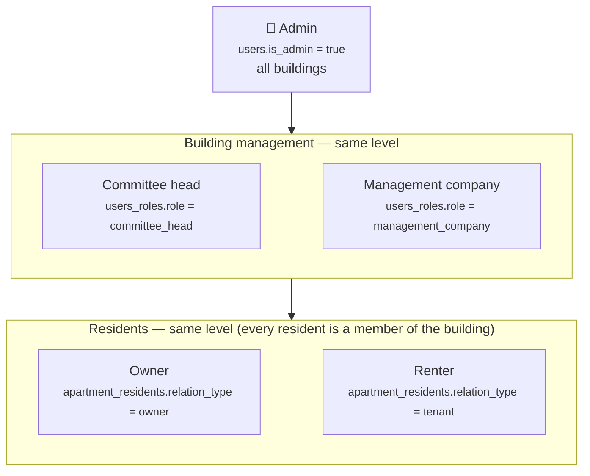
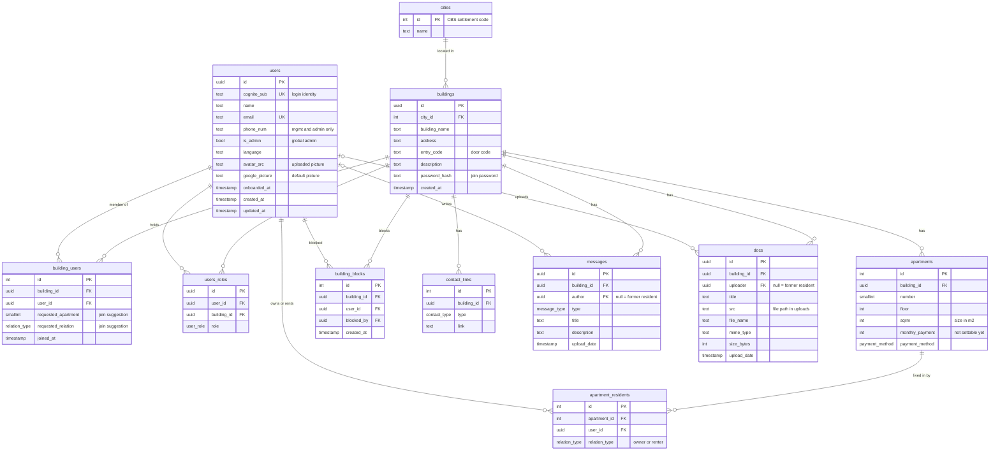

# buildy — database structure

> **Living document.** Update it in the same change as any edit to `backend/prisma/schema.prisma` or the role/permission rules.
> Last updated: **2026-10-06** · schema migrations up to `20261006130000_dedupe_building_roles`.

PostgreSQL, managed with Prisma 7 (`backend/prisma/schema.prisma`). Table and column names are snake_case in the database (Prisma maps them to camelCase in code).

---

## 1. Who's who — the user hierarchy

Three levels:

| Level | Who | Where it's stored | Scope | What they can do |
|---|---|---|---|---|
| 1 | **Admin** | `users.is_admin = true` | Every building | Everything below, plus: create / delete / rename / move buildings, contact links, **assign roles**, edit or delete anyone's messages and documents, remove or block building management. Granted only with `npm run admin:grant -- <email>`. |
| 2 | **Committee head** (יו"ר הוועד) | `users_roles.role = committee_head` | Their building(s) | Everything a resident can, plus in that building: edit members' **technical info** (apartments, owner/renter, floor, size, payment method), confirm join suggestions, **remove** or **block / unblock** residents, edit the building's **description, door code and join password**, see members' phone numbers. Cannot remove/block themselves, each other or admins. |
| 2 | **Management company** (חברת ניהול) | `users_roles.role = management_company` | Their building(s) | Exactly the same powers as the committee head. |
| 3 | **Resident** — owner or renter | `users_roles.role = resident` (given on joining) | Their building(s) | See the building, its members, messages, documents and contacts; post messages and upload documents; edit/delete **their own**; edit their **private info** (name, picture, phone, language, theme, home layout); leave a building. |

**Owner and renter are the same level** — both are residents. Which one someone is, is stored per apartment in `apartment_residents.relation_type`:

| `relation_type` | Meaning |
|---|---|
| `owner` | Owns the apartment (and may live in it). |
| `tenant` | **Rents** the apartment — in the database "tenant" means *renter*. |

How the pieces fit:
- **Admin is global** (a flag on the user); levels 2 and 3 are **per building** (a row in `users_roles` for that building). One person can be a committee head in one building and a resident in another, and an admin can also live in a building.
- **There is no "committee member" role** — every resident is a member of the building.
- Each member holds **one** role per building. Joining gives `resident`; only an admin changes roles.
- **Role and ownership are independent**: a committee head can be an owner or a renter.
- **Private vs technical info**: users edit their own private info; apartments, owner/renter and payment method are technical info set by building management (level 2) or an admin.
- When joining, a user may **suggest** an apartment number and owner/renter (`building_users.requested_*`). It's only a suggestion until management sets the real apartments, which clears it.

---

## 2. Tables at a glance

---

## 3. Tables in detail

### `cities`
The official list of Israeli cities and settlements (1,316 rows) from the Central Bureau of Statistics, seeded from `backend/prisma/data/cities.json`.

| Column | Type | Notes |
|---|---|---|
| `id` | int, PK | The CBS "סמל יישוב" code (e.g. 5000 = Tel Aviv-Yafo). Never auto-generated. |
| `name` | text | Hebrew name. |

### `buildings`
| Column | Type | Notes |
|---|---|---|
| `id` | uuid, PK | |
| `city_id` | int → `cities.id` | Admin-only to change. |
| `building_name` | text | Admin-only to change. |
| `address` | text | Unique together with `city_id`. Admin-only to change. |
| `entry_code` | text, optional | Door code — text so leading zeros survive ("0821"). Building management can edit. |
| `description` | text, optional | Building management can edit. |
| `password_hash` | text | Hashed shared **join password** (like an invite code). Building management can change it. |
| `created_at` | timestamp | |

### `users`
One row per person who signed in. Holds **private info** only.

| Column | Type | Notes |
|---|---|---|
| `id` | uuid, PK | |
| `cognito_sub` | text, unique | Login identity from AWS Cognito. |
| `name` | text, optional | Edited by the user (synced from the onboarding profile). |
| `email` | text, optional, unique | From the Google/Cognito login. |
| `phone_num` | text, optional | Optional, edited by the user; visible only to building management and admins. |
| `is_admin` | bool | **Global admin** — top of the hierarchy. |
| `language`, `onboarded_at` | | Onboarding profile. |
| `avatar_src` | text, optional | Uploaded profile picture: `UPLOADS_DIR/avatars/<userId>-<uuid>.<ext>` (PNG/JPEG/WebP/GIF, ≤ 2 MB). |
| `google_picture` | text, optional | Google photo URL from the login token — the default picture. |
| `created_at`, `updated_at` | timestamp | |

### `building_users` — membership
One row per person per building (unique `building_id` + `user_id`). A user can belong to **several buildings**.

| Column | Type | Notes |
|---|---|---|
| `id` | int, PK | |
| `building_id`, `user_id` | uuid FKs | |
| `requested_apartment` | smallint, optional | Apartment number the user suggested when joining. |
| `requested_relation` | `owner` / `tenant`, optional | Owner/renter the user suggested when joining. Both cleared when management sets the real apartments. |
| `joined_at` | timestamp | |

### `users_roles` — role in a building
| Column | Type | Notes |
|---|---|---|
| `id` | uuid, PK | |
| `user_id`, `building_id` | uuid FKs | |
| `role` | `committee_head` / `management_company` / `resident` | One per member per building (the app replaces it on change). Levels: see §1. Admin-only to change. |

### `apartments` — technical info
A physical apartment in a building (unique `building_id` + `number`). Set by building management or an admin.

| Column | Type | Notes |
|---|---|---|
| `id` | int, PK | |
| `building_id` | uuid FK | |
| `number` | smallint | Apartment number. |
| `floor` | int, optional | |
| `sqrm` | int, optional | Size in m². |
| `monthly_payment` | int, optional | Monthly building fee — **nothing sets it yet** (fees are a later iteration). |
| `payment_method` | `cash` / `transfer` / `bit` / `paybox`, optional | How this apartment pays. |

### `apartment_residents`
Who owns or rents which apartment (unique `apartment_id` + `user_id`). A user can have **several apartments** in one building, and an apartment can have an **owner and a renter**.

| Column | Type | Notes |
|---|---|---|
| `id` | int, PK | |
| `apartment_id` | int FK | |
| `user_id` | uuid FK | |
| `relation_type` | `owner` / `tenant` | Owner or **renter**. |

### `building_blocks`
Users who can't (re)join a building until unblocked (unique `building_id` + `user_id`).

| Column | Type | Notes |
|---|---|---|
| `id` | int, PK | |
| `building_id`, `user_id` | FKs | |
| `blocked_by` | uuid → `users.id`, optional | Who blocked them (null if that account was deleted). |
| `created_at` | timestamp | |

### `contact_links`
| Column | Type | Notes |
|---|---|---|
| `id` | int, PK | |
| `building_id` | uuid FK | |
| `type` | `whatsapp` / `phone` / `email` | Admin-only to manage. |
| `link` | text | WhatsApp must be an `https://` link; checked per type. |

### `messages`
| Column | Type | Notes |
|---|---|---|
| `id` | uuid, PK | |
| `building_id` | uuid FK | |
| `author` | uuid → `users.id`, optional | `NULL` once the author deleted their account → shown as "Former resident". |
| `type` | `general` / `urgent` / `maintenance` | "Report an issue" = `maintenance`. |
| `title`, `description` | text | Description optional. |
| `upload_date` | timestamp | |

### `docs`
The database keeps only the details; the file itself lives on disk under `UPLOADS_DIR` (the `uploads` Docker volume).

| Column | Type | Notes |
|---|---|---|
| `id` | uuid, PK | |
| `building_id` | uuid FK | |
| `uploader` | uuid → `users.id`, optional | `NULL` once the uploader deleted their account → "Former resident". |
| `title` | text | |
| `src` | text | Server-generated path `<buildingId>/<uuid><ext>`. |
| `file_name`, `mime_type`, `size_bytes` | | Original name, type (allow-listed), size (≤ 10 MB). |
| `upload_date` | timestamp | |

---

## 4. What happens on delete

| Deleting… | Also deletes | Keeps |
|---|---|---|
| a **building** | its memberships, roles, apartments (+ residents), blocks, contact links, messages, docs — and the uploaded files on disk | — |
| a **user** (account deletion) | their memberships, roles, apartment links, blocks against them, and their picture file | their messages and docs (author/uploader set to NULL → "Former resident"); blocks they made (`blocked_by` → NULL) |
| a **member** from one building (leave / remove / block) | their membership, role and apartment links **in that building** | the apartments themselves, their content, other buildings |
| a **city** | — | blocked while any building is in it |

---

## 5. Not used yet

- `apartments.monthly_payment` — shown to residents, but nothing can set it (fees and payment tracking are a later iteration).
- No audit log of management/admin actions yet.
