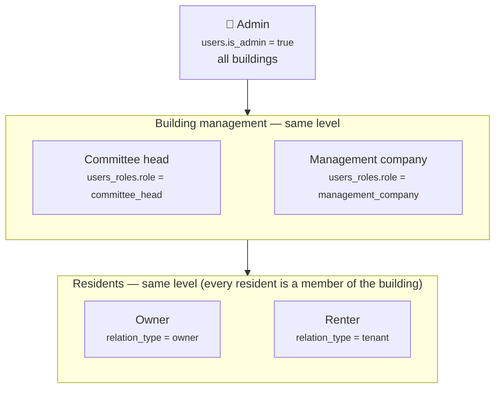
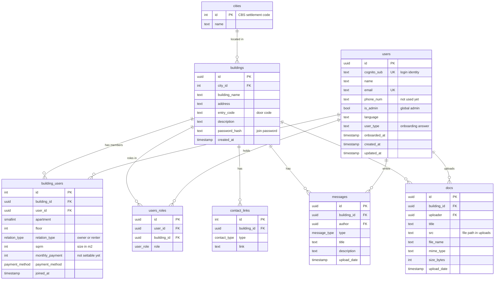

# buildy — database structure

> **Living document.** Update it in the same change as any edit to `backend/prisma/schema.prisma` or the role/permission rules.
> Last updated: **2026-10-06** · schema migrations up to `20261006000000_simplify_building_roles`.

PostgreSQL, managed with Prisma 7 (`backend/prisma/schema.prisma`). Table and column names are snake_case in the database (Prisma maps them to camelCase in code).

---

## 1. Who's who — the user hierarchy

Three levels:

| Level | Who | Where it's stored | Scope | What they can do **today** |
|---|---|---|---|---|
| 1 | **Admin** | `users.is_admin = true` | Every building | Everything: create/edit/delete buildings, contact links, member roles, remove members, edit/delete any message or document. Granted only with `npm run admin:grant -- <email>`. |
| 2 | **Committee head** (יו"ר הוועד) | `users_roles.role = committee_head` | One building | Same as a resident for now — shown first on the members list, under "Building management". |
| 2 | **Management company** (חברת ניהול) | `users_roles.role = management_company` | One building | Same level as the committee head; same as a resident for now. |
| 3 | **Resident** — owner or renter | `users_roles.role = resident` (given on joining) | One building | See the building, its members, messages, documents and contacts; post messages and upload documents; edit/delete **their own**; edit their own apartment details. |

**Owner and renter are the same level** — both are residents. Which one someone is, is stored per apartment in `building_users.relation_type`:

| `relation_type` | Meaning |
|---|---|
| `owner` | Owns the apartment (and may live in it). |
| `tenant` | **Rents** the apartment — in the database "tenant" means *renter*. |
| `NULL` | Not filled in yet. |

How the pieces fit:
- **Admin is global** (a flag on the user); levels 2 and 3 are **per building** (a row in `users_roles` for that building). An admin who also lives in a building has both.
- **There is no "committee member" role** — every resident is a member of the building.
- Each member holds **one** building role. Joining gives `resident`; only an admin can change it (for now).
- **Role and ownership are independent**: a committee head can be an owner or a renter.
- The onboarding answer "owner / tenant / committee / manager" (`users.user_type`) is only a **self-description** — it pre-fills `relation_type` on joining but never grants a role.
- Level-2 roles don't carry extra permissions yet — see the open questions in [NEXT_ITERATION.md](NEXT_ITERATION.md).

---

## 2. Tables at a glance

---

## 3. Tables in detail

### `cities`
The official list of Israeli cities and settlements (1,316 rows) from the Central Bureau of Statistics, seeded from `backend/prisma/data/cities.json`.

| Column | Type | Notes |
|---|---|---|
| `id` | int, PK | The CBS "סמל יישוב" code (e.g. 5000 = Tel Aviv-Yafo). Never auto-generated. |
| `name` | text | Hebrew name. |

### `buildings`
| Column | Type | Notes |
|---|---|---|
| `id` | uuid, PK | |
| `city_id` | int → `cities.id` | |
| `building_name` | text | |
| `address` | text | Unique together with `city_id`. |
| `entry_code` | text, optional | Door code — text so leading zeros survive ("0821"). |
| `description` | text, optional | |
| `password_hash` | text | Hashed shared **join password** (like an invite code). |
| `created_at` | timestamp | |

### `users`
One row per person who signed in.

| Column | Type | Notes |
|---|---|---|
| `id` | uuid, PK | |
| `cognito_sub` | text, unique | Login identity from AWS Cognito. |
| `name` | text, optional | Synced from the onboarding profile. |
| `email` | text, optional, unique | From the Google/Cognito login. |
| `phone_num` | text, optional | **Not collected yet.** |
| `is_admin` | bool | **Global admin** — top of the hierarchy. |
| `language`, `user_type`, `onboarded_at` | | Onboarding profile; `user_type` is self-described only. |
| `created_at`, `updated_at` | timestamp | |

### `building_users` — membership + the member's apartment
One row per person per building (unique `building_id` + `user_id`). Today a user belongs to one building at a time.

| Column | Type | Notes |
|---|---|---|
| `id` | int, PK | |
| `building_id`, `user_id` | uuid FKs | |
| `apartment` | smallint, optional | |
| `floor` | int, optional | |
| `relation_type` | `owner` / `tenant`, optional | Owner or **renter** — see §1. |
| `sqrm` | int, optional | Apartment size in m². |
| `monthly_payment` | int, optional | Monthly building fee — **no UI/API sets it yet**. |
| `payment_method` | `cash` / `transfer` / `bit` / `paybox`, optional | |
| `joined_at` | timestamp | |

### `users_roles` — role in a building
| Column | Type | Notes |
|---|---|---|
| `id` | uuid, PK | |
| `user_id`, `building_id` | uuid FKs | |
| `role` | `committee_head` / `management_company` / `resident` | One per member (the app replaces it on change). Levels: see §1. |

### `contact_links`
| Column | Type | Notes |
|---|---|---|
| `id` | int, PK | |
| `building_id` | uuid FK | |
| `type` | `whatsapp` / `phone` / `email` | |
| `link` | text | WhatsApp must be an `https://` link; checked per type. |

### `messages`
| Column | Type | Notes |
|---|---|---|
| `id` | uuid, PK | |
| `building_id` | uuid FK | |
| `author` | uuid → `users.id` | |
| `type` | `general` / `urgent` / `maintenance` | "Report an issue" = `maintenance`. |
| `title`, `description` | text | Description optional. |
| `upload_date` | timestamp | |

### `docs`
The database keeps only the details; the file itself lives on disk under `UPLOADS_DIR` (the `uploads` Docker volume).

| Column | Type | Notes |
|---|---|---|
| `id` | uuid, PK | |
| `building_id` | uuid FK | |
| `uploader` | uuid → `users.id` | |
| `title` | text | |
| `src` | text | Server-generated path `<buildingId>/<uuid><ext>`. |
| `file_name`, `mime_type`, `size_bytes` | | Original name, type (allow-listed), size (≤ 10 MB). |
| `upload_date` | timestamp | |

---

## 4. What happens on delete

| Deleting… | Also deletes | Blocked if… |
|---|---|---|
| a **building** | its memberships, roles, contact links, messages, docs — and the uploaded files on disk | — |
| a **user** | their memberships and roles | they wrote messages or uploaded docs (no account deletion flow yet) |
| a **city** | — | any building is in it |

---

## 5. Not used yet

- `users.phone_num` — never collected.
- `building_users.monthly_payment` — shown to residents, but nothing can set it.
- Committee head / management company roles — stored and displayed, but grant no extra permissions yet.

These are the open questions in [NEXT_ITERATION.md](NEXT_ITERATION.md) §3.
