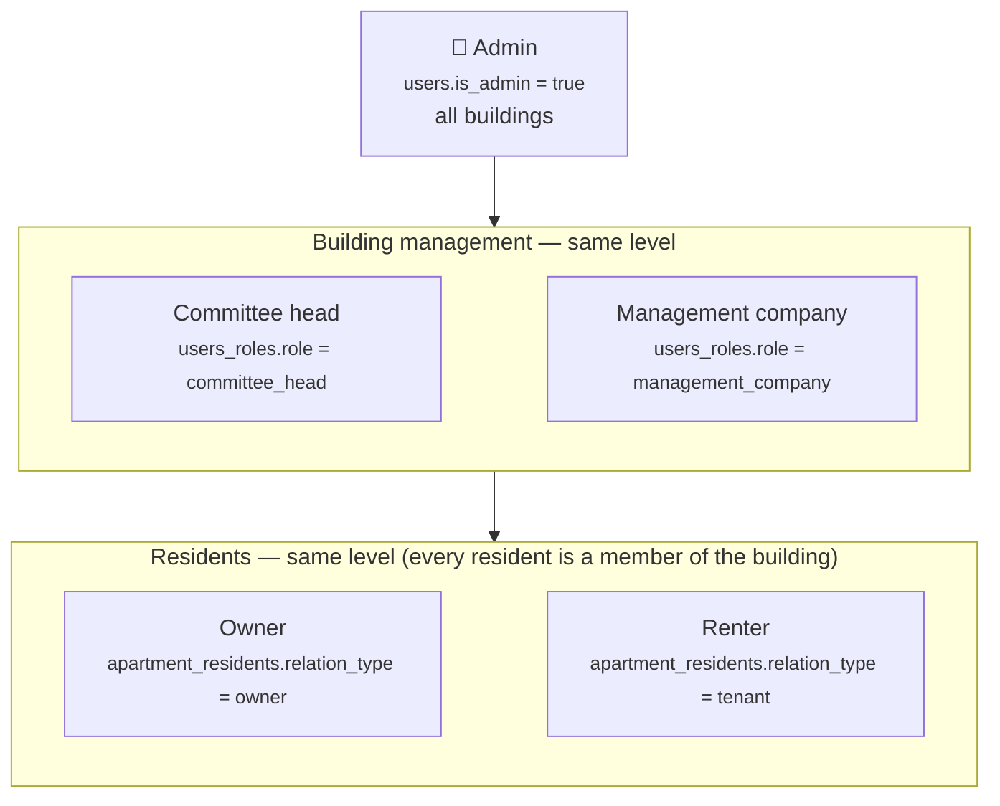
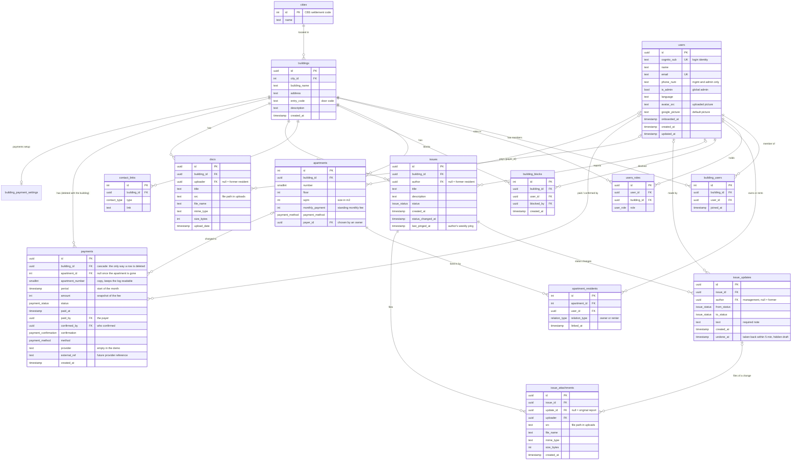

# buildy — database structure

> Purpose: the current database structure: tables, fields, the user hierarchy and how everything connects.

> **Living document.** Update it in the same change as any edit to `backend/prisma/schema.prisma` or the role/permission rules.
> Last updated: **2026-10-22** · schema migrations up to `20261022020000_payments_round2`.

PostgreSQL, managed with Prisma 7 (`backend/prisma/schema.prisma`). Table and column names are snake_case in the database (Prisma maps them to camelCase in code).

---

## 1. Who's who — the user hierarchy

Three levels:

| Level | Who | Where it's stored | Scope | What they can do |
|---|---|---|---|---|
| 1 | **Admin** | `users.is_admin = true` | Every building | Everything below, plus: create buildings without joining them, delete / rename / move buildings, contact links, **assign roles**, change statuses and edit or delete anyone's issues, edit or delete anyone's documents, remove or block building management. Granted only with `npm run admin:grant -- <email>`. |
| 2 | **Committee head** (יו"ר הוועד) | `users_roles.role = committee_head` | Their building(s) | Everything a resident can, plus in that building: edit members' **technical info** (apartments, owner/renter, floor, size, payment method), **add residents by their user ID** (single or a whole pasted list — apartments and owner/renter set in one table), **remove** or **block / unblock** residents, **change the status of issues** (a note is required), edit the building's **description, door code and contact links** (name, city and address stay admin-only), see members' phone numbers. Cannot remove/block themselves, each other or admins. |
| 2 | **Management company** (חברת ניהול) | `users_roles.role = management_company` | Their building(s) | Exactly the same powers as the committee head. **Anyone can create a building** and becomes its committee head or management company (their choice) — nothing checks who they really are; a building nobody was added to stays empty. |
| 3 | **Resident** — owner or renter | `users_roles.role = resident` (given on joining) | Their building(s) | See the building, its members, issues, documents and contacts; report issues (with pictures/files) and **ping** their own open issue once a week; upload documents; edit/delete **their own** documents and their own issues while still *opened*; edit their **private info** (name, picture, phone, language, theme, home layout); leave a building. |

**Owner and renter are the same level** — both are residents. Which one someone is, is stored per apartment in `apartment_residents.relation_type`:

| `relation_type` | Meaning |
|---|---|
| `owner` | Owns the apartment (and may live in it). |
| `tenant` | **Rents** the apartment — in the database "tenant" means *renter*. |

How the pieces fit:
- **Admin is global** (a flag on the user); levels 2 and 3 are **per building** (a row in `users_roles` for that building). One person can be a committee head in one building and a resident in another, and an admin can also live in a building.
- **There is no "committee member" role** — every resident is a member of the building.
- Each member holds **one** role per building. Being added gives `resident`; only an admin changes roles.
- **Role and ownership are independent**: a committee head can be an owner or a renter.
- **Admins can preview a level** (*View as*: committee head, management company or resident — 2026-10-08). Nothing is stored in the database: it's a per-request header (`X-View-As`) that only takes powers away, and management roles in it are ignored for non-admins.
- **Private vs technical info**: users edit their own private info; apartments, owner/renter and payment method are technical info set by building management (level 2) or an admin.
- **Nobody joins by themselves.** A new user shows their user ID (`users.id`) on the home screen and sends it to the committee head, who adds them to the building with their apartment(s) and owner/renter. Until then they are in no building and see only their ID, their profile and settings.

---

## 2. Tables at a glance

---

## 3. Tables in detail

### `cities`
The official list of Israeli cities and settlements (1,316 rows) from the Central Bureau of Statistics, seeded from `backend/prisma/data/cities.json`.

| Column | Type | Notes |
|---|---|---|
| `id` | int, PK | The CBS "סמל יישוב" code (e.g. 5000 = Tel Aviv-Yafo). Never auto-generated. |
| `name` | text | Hebrew name. |

### `buildings`
| Column | Type | Notes |
|---|---|---|
| `id` | uuid, PK | |
| `city_id` | int → `cities.id` | Admin-only to change. |
| `building_name` | text | Admin-only to change. |
| `address` | text | Unique together with `city_id`. Admin-only to change. A building can be created by any user (see §1), so the first to claim an address holds it until an admin steps in. |
| `entry_code` | text, optional | Door code — text so leading zeros survive ("0821"). Building management can edit. |
| `description` | text, optional | Building management can edit. |
| `created_at` | timestamp | |

### `users`
One row per person who signed in. Holds **private info** only.

| Column | Type | Notes |
|---|---|---|
| `id` | uuid, PK | |
| `cognito_sub` | text, unique | Login identity from AWS Cognito. |
| `name` | text, optional | Edited by the user (synced from the onboarding profile). |
| `email` | text, optional, unique | From the Google/Cognito login. |
| `phone_num` | text, optional | Optional, edited by the user; visible only to building management and admins. |
| `is_admin` | bool | **Global admin** — top of the hierarchy. |
| `language`, `onboarded_at` | | Onboarding profile. |
| `avatar_src` | text, optional | Uploaded profile picture: S3 key `users/<userId>/avatars/<uuid>-<safe-name>` (PNG/JPEG/WebP/GIF, ≤ 2 MB). |
| `google_picture` | text, optional | Google photo URL from the login token — the default picture. |
| `created_at`, `updated_at` | timestamp | |

### `building_users` — membership
One row per person per building (unique `building_id` + `user_id`), created by building management adding the user's ID (or by creating the building). A user can belong to **several buildings**.

| Column | Type | Notes |
|---|---|---|
| `id` | int, PK | |
| `building_id`, `user_id` | uuid FKs | |
| `joined_at` | timestamp | |

### `users_roles` — role in a building
| Column | Type | Notes |
|---|---|---|
| `id` | uuid, PK | |
| `user_id`, `building_id` | uuid FKs | |
| `role` | `committee_head` / `management_company` / `resident` | One per member per building (the app replaces it on change). Levels: see §1. Admin-only to change; the creator of a building gets their chosen management role. |

### `apartments` — technical info
A physical apartment in a building (unique `building_id` + `number`). Set by building management or an admin.

| Column | Type | Notes |
|---|---|---|
| `id` | int, PK | |
| `building_id` | uuid FK | |
| `number` | smallint | Apartment number. |
| `floor` | int, optional | |
| `sqrm` | int, optional | Size in m². |
| `monthly_payment` | int, optional | The apartment's own **standing** monthly fee (₪). Building management changes it with "permanent" in the Payments tile; every month that is opened copies it into a `payments` row. Empty = the building's `default_fee` (else 0). |
| `payment_method` | `card` / `cash` / `transfer` / `bit_paybox`, optional | How this apartment usually pays (Bit and PayBox are one method). Pre-selected when a payment is confirmed; empty = the building's `default_method`, else card. |
| `payer_id` | uuid → `users.id`, optional | Who pays the fee — chosen by an **owner** of the apartment (themselves or the renter). Empty, or no longer linked to the apartment = the first-linked owner pays (with no owner, the renter). `SET NULL` on account deletion. Only the payer gets the demo Pay button. |

### `apartment_residents`
Who owns or rents which apartment (unique `apartment_id` + `user_id`). A user can have **several apartments** in one building, and an apartment can have an **owner and a renter**.

| Column | Type | Notes |
|---|---|---|
| `id` | int, PK | |
| `apartment_id` | int FK | |
| `user_id` | uuid FK | |
| `relation_type` | `owner` / `tenant` | Owner or **renter**. |
| `linked_at` | timestamp | When they were linked to the apartment. A resident sees the apartment's payments only from that month on (a previous resident's months stay private). Kept when management re-saves the member's apartments; reset if they are removed and added again. Existing links were backfilled with `building_users.joined_at`. |

### `building_blocks`
Users who can't be added to a building until unblocked (unique `building_id` + `user_id`).

| Column | Type | Notes |
|---|---|---|
| `id` | int, PK | |
| `building_id`, `user_id` | FKs | |
| `blocked_by` | uuid → `users.id`, optional | Who blocked them (null if that account was deleted). |
| `created_at` | timestamp | |

### `contact_links`
| Column | Type | Notes |
|---|---|---|
| `id` | int, PK | |
| `building_id` | uuid FK | |
| `type` | `whatsapp` / `phone` / `email` | Admin-only to manage. |
| `link` | text | WhatsApp must be an `https://` link; checked per type. |

### `issues`
A problem a resident reports. Visible to the whole building. Status flow: `opened` → `in_process` (accepted) or `denied`; `in_process` → `resolved`. Denied and resolved are final — nothing can change after them. While `in_process`, management or the author can still add updates (text and/or files) without changing the status. More statuses and issue types later.

| Column | Type | Notes |
|---|---|---|
| `id` | uuid, PK | |
| `building_id` | uuid FK | |
| `author` | uuid → `users.id`, optional | `NULL` once the author deleted their account → "Former resident". |
| `title`, `description` | text | Description optional. |
| `status` | `opened` / `in_process` / `denied` / `resolved` | Only building management (and admins) change it, and only along the flow above. The author edits/deletes while `opened`; nobody edits a closed issue. |
| `created_at`, `status_changed_at` | timestamp | |
| `last_pinged_at` | timestamp, optional | The author's last "ping" (allowed once every 7 days, only while `opened`/`in_process`). The list sorts active issues by `last_pinged_at ?? created_at`, newest first, so a ping brings an issue back to the top. |

### `issue_updates`
One row per status change or in-process update (history). A status change needs a note; an update (`from_status` = `to_status` = `in_process`) needs text or a file (`text` may then be empty).

| Column | Type | Notes |
|---|---|---|
| `issue_id` | uuid FK | Cascade. |
| `author` | uuid → `users.id`, optional | Who changed it (management); `NULL` once they deleted their account. |
| `from_status`, `to_status` | `issue_status` | |
| `text` | text | Why / what happens next (e.g. the reason for a denial). |
| `created_at` | timestamp | |
| `undone_at` | timestamp, optional | Set when the author took the update (or a resolve) back with **Undo**, allowed for 5 minutes after `created_at` and only for the newest update. The row is then hidden from the history and kept, with its files, as the author's editable draft; it is deleted 5 minutes after `undone_at`, or as soon as the author sends something new. Undoing a resolve moves the issue back to `in_process`. Accepting and denying can't be undone. |

### `issue_attachments`
Pictures and files on an issue — on the original report (`update_id` NULL) or on a status change. Same rules as documents: allow-listed types, ≤ 10 MB, up to 10 per submission. S3 keys: `buildings/<buildingId>/images/<uuid>-<safe-name>` (image/*) or `buildings/<buildingId>/documents/<uuid>-<safe-name>`.

| Column | Type | Notes |
|---|---|---|
| `issue_id` | uuid FK | Cascade. |
| `update_id` | uuid FK, optional | Cascade. |
| `uploader` | uuid → `users.id`, optional | `NULL` once the uploader deleted their account. |
| `src` | text | Server-generated path `<buildingId>/issues/<uuid><ext>`. |
| `file_name`, `mime_type`, `size_bytes` | | Original name, type, size. |
| `created_at` | timestamp | |

### `payments` — monthly fees (demo)
A permanent log: one row per apartment per month, created when the **month opens**: by building management's click, or by itself on the building's open day (see `building_payment_settings`). Each charge's `amount` is copied from `apartments.monthly_payment`, else the building's `default_fee`. Unique per building + apartment number + month. No partial payments and **no undo**: a charge is `unpaid` or `paid`. Changing a fee with "one-time" edits only this month's unpaid charge; "permanent" also edits the standing fee. Paid charges and past months never change; only the current month can be changed.

| Column | Type | Notes |
|---|---|---|
| `id` | uuid, PK | |
| `building_id` | uuid FK | **Cascade — payments are deleted only with their building.** |
| `apartment_id` | int FK, optional | `SET NULL` if the apartment is ever deleted; payments are never removed because a resident or apartment left. |
| `apartment_number` | smallint | Copy of the number, so the log reads after `apartment_id` is gone. |
| `period` | timestamp | Start of the period: the first day of the month (Israel time, stored as midnight UTC). In dev, `PAYMENTS_PERIOD_MINUTES=5` makes each period 5 minutes long, for demos. |
| `amount` | int | Snapshot of the fee for that month (₪). |
| `status` | `unpaid` / `pending` / `paid` / `failed` | The demo uses `unpaid` and `paid`; `pending` / `failed` are for a future payment provider. |
| `paid_at` | timestamp, optional | When it was paid ("paid on"; `period` is the month it is *for*). |
| `paid_by` | uuid → `users.id`, optional | **Who paid**: the apartment's payer at that moment (rows before 2026-10-22 hold whoever marked them paid). `SET NULL` on account deletion. |
| `confirmed_by` | uuid → `users.id`, optional | **Who confirmed** it: building management, or the resident themselves (demo Pay). `SET NULL` on account deletion. |
| `confirmation` | `single` / `bulk` / `self` / `automatic`, optional | **How** it was confirmed: management clicked this apartment, "Mark all", the resident's own Pay, or (later) a payment provider. Empty on older rows. |
| `method` | `payment_method`, optional | How it was paid — pre-selected from the apartment (then the building, then card), changeable per payment by management. "Mark all" uses each apartment's own. Empty on older rows. |
| `provider`, `external_ref` | text, optional | Empty in the demo; a future third-party provider fills them. |
| `created_at` | timestamp | |

Privacy: building management sees every apartment's charge, the collected / goal total and the building-wide **payments log**; a resident sees only the apartments they own or rent, and in each apartment's log only the months since their `linked_at`.

### `building_payment_settings` — a building's payments setup
One row per building (no row = not set up yet: the Payments tile asks management to set it up). Filled by the "Create a building" wizard's payments step or from the tile; changes apply to coming months. Deleted with the building.

| Column | Type | Notes |
|---|---|---|
| `building_id` | uuid, PK + FK | Cascade. |
| `open_mode` | `manual` / `auto` | `manual`: management presses *Open this month*. `auto`: the month opens by itself the first time anyone looks on or after `open_day` (no scheduler; right away in the dev 5-minute test mode). Management can still open it early by hand. |
| `open_day` | smallint | Day of the month (1–28) for `auto`. |
| `default_fee` | int, optional | Fee of every apartment without its own `monthly_payment`. |
| `default_method` | `payment_method`, optional | Method pre-selected for apartments without their own. |
| `created_at`, `updated_at` | timestamp | |

### `docs`
The database keeps only the details; the file itself lives in the private S3 bucket (`S3_BUCKET`). `src` is the object key: `buildings/<buildingId>/images/<uuid>-<safe-name>` for image/* files, `buildings/<buildingId>/documents/<uuid>-<safe-name>` for everything else (`safe-name` = lowercase `[a-z0-9._-]`, truncated).

| Column | Type | Notes |
|---|---|---|
| `id` | uuid, PK | |
| `building_id` | uuid FK | |
| `uploader` | uuid → `users.id`, optional | `NULL` once the uploader deleted their account → "Former resident". |
| `title` | text | |
| `src` | text | Server-generated path `<buildingId>/<uuid><ext>`. |
| `file_name`, `mime_type`, `size_bytes` | | Original name, type (allow-listed), size (≤ 10 MB). |
| `upload_date` | timestamp | |

---

## 4. What happens on delete

| Deleting… | Also deletes | Keeps |
|---|---|---|
| a **building** | its memberships, roles, apartments (+ residents), blocks, contact links, issues (+ updates and attachments), docs — and the uploaded files on disk | — |
| a **user** (account deletion) | their memberships, roles, apartment links, blocks against them, and their picture file | their issues, status changes, attachments and docs (author/uploader set to NULL → "Former resident"); blocks they made (`blocked_by` → NULL) |
| a **member** from one building (leave / remove / block) | their membership, role and apartment links **in that building** | the apartments themselves, their issues and other content, other buildings |
| an **issue** | its status changes and attachments — and the files on disk | — |
| a **city** | — | blocked while any building is in it |

A building's **payments** are deleted only together with the building. Removing a member, replacing apartments or deleting an account keeps them.

---

## 5. Not used yet

- `payments.provider`, `external_ref` and the `pending` / `failed` statuses — reserved for a real payment provider.
- No audit log of management/admin actions yet.
